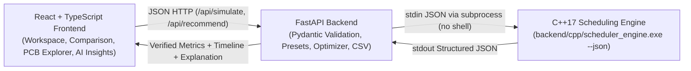

# SchedulAI — AI-Assisted CPU Scheduling Simulator & Optimizer

**SchedulAI** is an interactive, educational Operating Systems CPU scheduling simulator and simulation-backed algorithm optimizer. It combines a deterministic **C++17 scheduling engine** (evolved incrementally from the original `Miniproject.cpp` implementation) with a **FastAPI** backend and a **React + TypeScript** technical dashboard.

---

## 1. Project Overview & Problem Statement

CPU scheduling algorithms behave differently depending on process arrival patterns, burst time distributions, priority levels, and time quanta. An algorithm that minimizes waiting time on one workload may increase response time or cause starvation on another.

Manually calculating Completion Time (CT), Turnaround Time (TAT), Waiting Time (WT), Response Time (RT), and preemption boundaries across six policies is error-prone and time-consuming. **SchedulAI** automates these calculations using a compiled C++17 engine, visualizes proportional Gantt timelines and Process Control Block (PCB) state lifecycles, and provides an **explainable, simulation-backed recommendation** tailored to a user-selected optimization objective.

> **Important Scope & Honesty Boundary:**  
> SchedulAI is an educational CPU scheduling simulator, not a replacement for the host OS kernel scheduler. Its recommendation system is a **transparent, rule-guided, simulation-backed optimizer** that verifies every candidate against actual C++ simulation results—it does not claim to use an unverified or black-box machine-learning model.

---

## 2. Key Features

- **Six CPU Scheduling Variants** executed in C++17:
  1. **First Come, First Served (`FCFS`)** — Non-preemptive arrival-order scheduling.
  2. **Shortest Job First (`SJF`)** — Non-preemptive shortest burst selection.
  3. **Shortest Remaining Time First (`SRTF`)** — Preemptive shortest remaining burst selection.
  4. **Priority Scheduling (`PRIORITY`)** — Non-preemptive priority selection (*smaller numeric value = higher priority*).
  5. **Preemptive Priority Scheduling (`PREEMPTIVE_PRIORITY`)** — Preempts running process when a higher-priority job arrives.
  6. **Round Robin (`RR`)** — Time-sliced execution with configurable positive time quantum and deterministic ready-queue ordering.
- **Accurate Per-Process & System Metrics**:
  - $\text{Turnaround Time (TAT)} = \text{Completion Time (CT)} - \text{Arrival Time (AT)}$
  - $\text{Waiting Time (WT)} = \text{Turnaround Time (TAT)} - \text{Burst Time (BT)}$ *(CPU-only model)*
  - $\text{Response Time (RT)} = \text{First CPU Start Time} - \text{Arrival Time (AT)}$
  - System averages ($\text{Avg WT}$, $\text{Avg TAT}$, $\text{Avg RT}$) and $\text{Throughput} = \frac{N}{\text{Final Completion Time}}$.
- **Proportional Interactive Gantt Charts**:
  - Displays process execution slices, preemption boundaries, duration labels, start/end timestamps, and distinct striped `Idle` intervals.
- **Process Explorer (PCB & State Lifecycle)**:
  - Inspect individual Process Control Block (PCB) attributes and state transitions derived directly from the simulation timeline (`New → Ready → Running → Ready (if preempted) → Terminated`).
- **Explainable AI Insights (Simulation-Backed Optimizer)**:
  - Extracts workload features (arrival spread, burst ratio, priority variation), selects an initial rule-based candidate, simulates all enabled algorithms on independent copies of the workload, and reports the verified winner, ties, and scheduling trade-offs.
- **Preset Workloads & CSV Export**:
  - Includes 6 curated classroom presets (`Preemption & Priority Showcase`, `Simultaneous Batch Arrivals`, `FCFS Convoy Effect`, `Sparse Arrivals with CPU Idle Gaps`, `Priority vs Remaining Time Conflict`, `Interactive Time-Sharing`) and full CSV export.

---

## 3. System Architecture & Data Flow



1. **Frontend (`frontend/`)**: Collects and validates workload inputs, renders proportional Gantt charts, comparison tables, PCB state timelines, and recommendation explanations. Never fabricates scheduling metrics.
2. **Backend (`backend/app/`)**: Validates payloads with Pydantic, invokes the compiled C++ binary using `subprocess.run([binary, "--json"])` with a 5-second timeout, runs the recommendation comparison, and generates CSV downloads.
3. **C++17 Engine (`backend/cpp/existing_scheduler.cpp`)**: The single source of truth for all scheduling calculations. Supports both interactive CLI mode (default) and machine-readable `--json` mode.

---

## 4. Project Directory Structure

```text
SchedulAI/
├── Miniproject.cpp                     # Original C++ scheduling source (preserved backup)
├── backend/
│   ├── cpp/
│   │   ├── existing_scheduler.cpp      # Refactored C++17 engine (6 algorithms + CLI & --json modes)
│   │   ├── scheduler_engine.exe        # Compiled Windows C++17 engine binary
│   │   └── tests/
│   │       └── test_scheduler.cpp      # Deterministic C++ unit test suite (8 test suites)
│   ├── app/
│   │   ├── main.py                     # FastAPI application entry point & CORS config
│   │   ├── routes/api.py               # /api/health, /api/presets, /api/simulate, /api/recommend, /api/export/csv
│   │   ├── schemas/scheduling.py       # Pydantic request/response models & validation rules
│   │   ├── services/
│   │   │   ├── engine.py               # Subprocess bridge to C++ executable
│   │   │   ├── presets.py              # Classroom workload presets
│   │   │   └── csv_export.py           # Multi-section CSV exporter
│   │   └── recommendations/
│   │       └── optimizer.py            # Rule-based candidate + simulation-backed verification
│   ├── tests/
│   │   └── test_api.py                 # Pytest API, validation, error, & integration tests
│   └── requirements.txt                # Locked Python dependencies
├── frontend/
│   ├── src/
│   │   ├── App.tsx                     # Main dashboard layout & state management
│   │   ├── App.test.tsx                # Vitest + React Testing Library test suite
│   │   ├── components/
│   │   │   ├── WorkspaceSection.tsx    # Process table, validation, presets, algorithm selector
│   │   │   ├── ComparisonSection.tsx   # Metric summary cards, comparison table, Gantt stack
│   │   │   ├── GanttChart.tsx          # Proportional timeline & CPU idle visualization
│   │   │   ├── ProcessExplorerSection.tsx # PCB inspector & derived state lifecycle
│   │   │   └── AiInsightsSection.tsx   # Optimizer recommendation, rationale, & trade-offs
│   │   ├── services/api.ts             # Typed HTTP client for FastAPI endpoints
│   │   └── types/scheduling.ts         # TypeScript interfaces & color palette
│   ├── package.json
│   └── vite.config.ts
├── sample-workloads/                   # Standalone JSON preset workloads
└── docs/                               # PRD.md, TRD.md, ARCHITECTURE.md, UI_UX_DESIGN.md
```

---

## 5. Windows Setup, Build, and Run Instructions

### Prerequisites
- **C++ Compiler**: `g++` (MinGW/GCC supporting `-std=c++17`)
- **Python**: Python 3.10+
- **Node.js**: Node 18+ and `npm`

### Step 1 — Compile the C++17 Scheduling Engine
From the repository root (`c:\Users\Admin\Documents\Projects\SchedulAI`) in PowerShell:
```powershell
g++ -std=c++17 -O2 backend/cpp/existing_scheduler.cpp -o backend/cpp/scheduler_engine.exe
```

### Step 2 — Set Up and Start the FastAPI Backend
```powershell
# Create virtual environment if not already created
python -m venv .venv

# Install dependencies
.\.venv\Scripts\pip.exe install -r backend/requirements.txt

# Start the FastAPI server on http://127.0.0.1:8000
.\.venv\Scripts\uvicorn.exe backend.app.main:app --host 127.0.0.1 --port 8000 --reload
```
- **Interactive Swagger API Docs**: Open `http://127.0.0.1:8000/docs`
- **Health Check**: Open `http://127.0.0.1:8000/api/health`

### Step 3 — Install and Start the React Frontend
In a second PowerShell terminal at the repository root:
```powershell
npm --prefix frontend install
npm --prefix frontend run dev
```
- **Web Application URL**: Open `http://localhost:5173` in your browser. Vite automatically proxies `/api/*` requests to `http://127.0.0.1:8000`.

---

## 6. Running Automated Tests

### 1. C++17 Scheduling Engine Unit Tests
```powershell
g++ -std=c++17 -O2 backend/cpp/tests/test_scheduler.cpp -o backend/cpp/tests/test_scheduler.exe
.\backend\cpp\tests\test_scheduler.exe
```

### 2. FastAPI Backend & Integration Tests (`pytest`)
```powershell
.\.venv\Scripts\python.exe -m pytest backend/tests/test_api.py -v
```

### 3. React Frontend Component & State Tests (`Vitest`)
```powershell
npm --prefix frontend run test
```

---

## 7. API Contract Examples

### `POST /api/simulate`
**Request:**
```json
{
  "processes": [
    {"id": 1, "arrival_time": 0, "burst_time": 6, "priority": 2},
    {"id": 2, "arrival_time": 1, "burst_time": 4, "priority": 1},
    {"id": 3, "arrival_time": 2, "burst_time": 8, "priority": 3}
  ],
  "algorithms": ["FCFS", "SJF", "SRTF", "PRIORITY", "PREEMPTIVE_PRIORITY", "RR"],
  "time_quantum": 2
}
```

**Expected Verified Results on this Workload:**

| Algorithm | Avg Waiting Time | Avg Turnaround Time | Avg Response Time | Execution Order (Gantt) |
|---|---:|---:|---:|---|
| **FCFS** | 4.33 | 10.33 | 4.33 | `P1[0→6], P2[6→10], P3[10→18]` |
| **SJF** | 4.33 | 10.33 | 4.33 | `P1[0→6], P2[6→10], P3[10→18]` |
| **Priority** | 4.33 | 10.33 | 4.33 | `P1[0→6], P2[6→10], P3[10→18]` |
| **SRTF** | **4.00** | **10.00** | 2.67 | `P1[0→1], P2[1→5], P1[5→10], P3[10→18]` |
| **Preemptive Priority** | **4.00** | **10.00** | 2.67 | `P1[0→1], P2[1→5], P1[5→10], P3[10→18]` |
| **Round Robin (Q=2)** | 7.00 | 13.00 | **1.00** | `P1[0→2], P2[2→4], P3[4→6], P1[6→8], P2[8→10], P3[10→12], P1[12→14], P3[14→18]` |

---

## 8. Known Limitations & Future Enhancements

### Current Limitations
- **CPU-Only Execution Model**: Processes execute pure CPU bursts without I/O blocking intervals; therefore, the `Blocked` process state is intentionally omitted.
- **Zero Context-Switch Overhead**: Context switches between preempted slices are modeled as instantaneous ($0$ time units) to match standard textbook OS calculations.
- **Integer Time Units**: Arrival times, burst times, and time quanta use integer time units (up to $100,000$ per process in the API, max $200$ processes per request).

### Future Enhancements
- Optional context-switch penalty parameter.
- I/O burst modeling to demonstrate the `Running → Blocked → Ready` transition.
- Multi-Level Feedback Queue (MLFQ) and aging visualization to mitigate starvation in priority scheduling.
