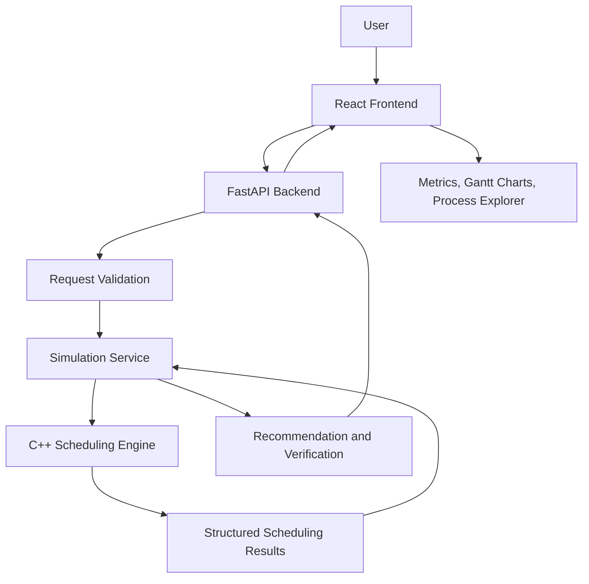
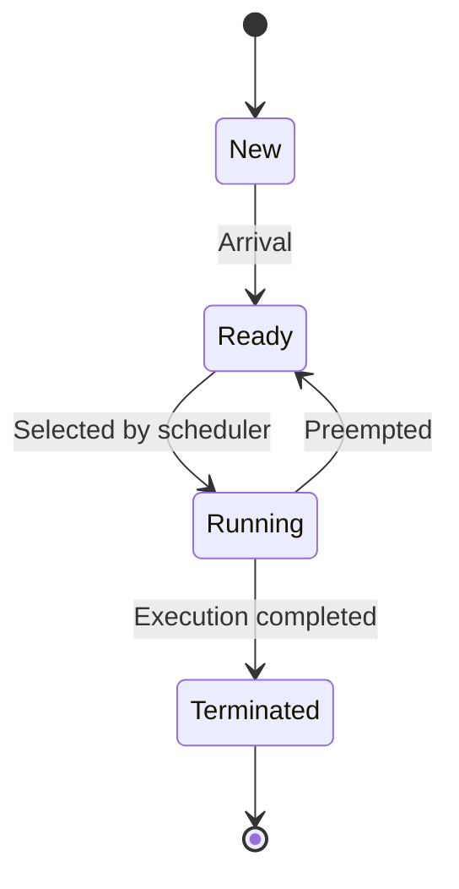
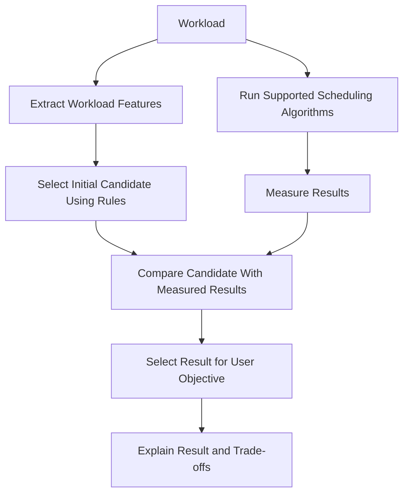

# SchedulAI — System Architecture

## 1. Architecture Overview

SchedulAI uses a layered architecture that separates the user interface, backend API, scheduling engine, and recommendation system.

The existing C++ code remains the foundation of the scheduling engine. The architecture extends it rather than replacing it with a new scheduling implementation in another language.

## 2. High-Level Architecture



## 3. Component Responsibilities

### 3.1 Frontend

**Technology:** React, TypeScript, Vite.

Responsibilities:
- Collect process inputs.
- Select algorithms and time quantum.
- Submit workloads.
- Display results and errors.
- Render Gantt charts.
- Compare scheduling metrics.
- Display recommendation explanations.
- Display PCB-like process information.
- Export or download CSV results.

The frontend shall not independently calculate authoritative scheduling results.

### 3.2 FastAPI Backend

Responsibilities:
- Validate requests.
- Enforce workload limits.
- Call the C++ scheduling executable.
- Parse structured results.
- Run recommendation logic.
- Prepare CSV exports.
- Return consistent API responses.

The backend acts as the integration layer and does not duplicate the main scheduling algorithms in Python.

### 3.3 C++ Scheduling Engine

Responsibilities:
- Execute the scheduling algorithms.
- Track process execution and remaining burst time.
- Generate timeline segments.
- Calculate process-level metrics.
- Calculate averages.
- Handle idle periods and preemption.
- Return structured output.

The engine should not depend on terminal formatting or frontend presentation.

### 3.4 Recommendation Service

Responsibilities:
- Identify workload characteristics.
- Apply transparent candidate-selection rules.
- Compare simulation results using the selected objective.
- Return the measured winner and trade-offs.
- Explain why the result was selected.

The initial implementation is rules-based and simulation-backed. A trained ML model is a future extension.

### 3.5 Testing Layer

Responsibilities:
- Validate algorithm correctness.
- Verify formulas.
- Test edge cases.
- Test API contracts.
- Check frontend rendering.
- Verify end-to-end data flow.

## 4. Request Lifecycle

1. The user creates a workload in the frontend.
2. The frontend sends a request to FastAPI.
3. FastAPI validates the request.
4. The simulation service converts it into the engine's input format.
5. The C++ executable runs the requested algorithms.
6. The engine returns structured results.
7. The backend verifies or compares the results for the selected objective.
8. FastAPI returns the response.
9. React renders metrics, Gantt charts, process details, and recommendation explanations.

## 5. Suggested Repository Structure

```text
SchedulAI/
├── backend/
│   ├── cpp/
│   │   ├── include/
│   │   │   ├── process.h
│   │   │   ├── scheduler.h
│   │   │   └── result.h
│   │   ├── src/
│   │   │   ├── main.cpp
│   │   │   ├── fcfs.cpp
│   │   │   ├── sjf.cpp
│   │   │   ├── priority.cpp
│   │   │   ├── srtf.cpp
│   │   │   ├── preemptive_priority.cpp
│   │   │   ├── round_robin.cpp
│   │   │   └── gantt.cpp
│   │   └── tests/
│   ├── app/
│   │   ├── main.py
│   │   ├── routes/
│   │   ├── schemas/
│   │   ├── services/
│   │   └── recommendations/
│   └── tests/
├── frontend/
├── sample-workloads/
├── docs/
└── README.md
```

This is the target structure. It is acceptable to begin with fewer files and split them once the existing code has been inspected.

## 6. Scheduling Engine Refactoring Strategy

### Current state

The existing source already contains several scheduling implementations and terminal output functions.

### Target state

Each scheduling algorithm accepts a workload and returns a consistent result object.

Conceptually:

```text
Input workload
    ↓
Algorithm function
    ↓
Timeline + process metrics + averages
    ↓
Structured JSON output
```

The algorithm should not print its final result as its only output. A separate CLI presentation layer may print a human-readable report from the same result object.

### Refactoring sequence

1. Back up the current source.
2. Compile and run the existing implementation.
3. Record current outputs for known workloads.
4. Add deterministic tests for expected results.
5. Standardize the result structures.
6. Separate calculation from terminal output.
7. Add preemptive Priority Scheduling.
8. Standardize tie-breaking, idle handling, and JSON output.
9. Re-run all tests.
10. Integrate the executable with FastAPI.

## 7. Data Flow and Contracts

The frontend and backend communicate through documented JSON requests and responses.

The C++ executable communicates with FastAPI through JSON on standard input and standard output.

Standard output should contain machine-readable JSON when running in API mode. Diagnostic messages should be written to standard error.

Each timeline segment should contain:
- Start time.
- End time.
- Process ID or an explicit idle marker.

Each algorithm result should contain:
- Algorithm ID and display name.
- Process-level metrics.
- Average metrics.
- Timeline segments.

The same workload input must be used independently for each algorithm. An algorithm must not modify the original workload used by another algorithm.

## 8. Process State Model

The Process Explorer presents a simplified state model:



A process may go from Running to Terminated without passing through Ready again.

A Blocked state is intentionally excluded from the initial version because the project does not simulate I/O blocking.

State transitions must be derived from the simulation timeline and event data, not guessed by the frontend.

## 9. Recommendation Architecture



The optimization objective must be visible to the user.

For example, minimizing average waiting time may select a different algorithm from minimizing average response time. There is no universal best algorithm for every workload and every objective.

## 10. Error Handling

The architecture shall account for:
- Invalid process data.
- Unsupported algorithms.
- Invalid time quantum.
- C++ executable missing or failing.
- Engine timeout.
- Invalid engine output.
- CSV export errors.
- Network failures between frontend and backend.

The frontend shall display understandable messages. Internal errors shall be logged without exposing sensitive implementation details.

## 11. Deployment Strategy

For the initial demonstration:
- Run the compiled C++ engine locally.
- Run FastAPI locally.
- Run the React development server locally.
- Configure the frontend API base URL.
- Document all startup commands in the README.

Production deployment can be considered after the local version is tested.

## 12. Architecture Principles

- Preserve and incrementally improve the existing backend.
- Keep scheduling calculations deterministic.
- Separate calculations from presentation.
- Keep the API contract explicit.
- Do not add a database unless a real requirement emerges.
- Do not claim the simulator is a real kernel scheduler.
- Keep recommendation explanations aligned with measured results.
